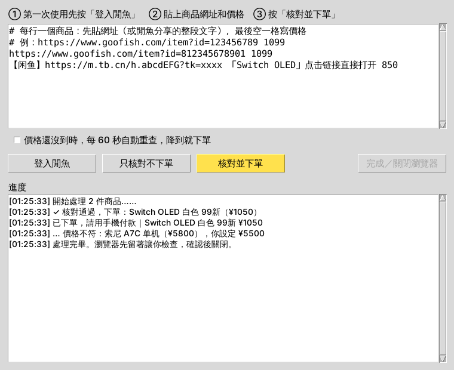

# 閒魚下單工具

貼上商品網址和價格，工具會先核對，確認無誤才自動下單。下單後停在「待付款」，你再用手機付款。



## 一、安裝（只要做一次）

1. 下載這個工具：[點這裡下載 ZIP](https://github.com/lesieann/for-claude-code/archive/refs/heads/ccr-7d25ed4f-s1bx3n.zip)
2. 解壓縮後，打開裡面的 `xianyu-order` 資料夾。
3. 雙擊 **`安裝.bat`**。
   - 如果電腦還沒有 Python，它會自動安裝。裝好後會請你關掉視窗，**再雙擊一次 `安裝.bat`**。
   - 看到「安裝完成」就可以關掉視窗。

## 二、第一次登入（只要做一次）

1. 雙擊 **`開始.bat`**，會跳出工具視窗。
2. 按 **「登入閒魚」**，會開一個瀏覽器。
3. 用手機閒魚 App 掃描瀏覽器上的 QR code 登入。
4. 登入好後，回到工具視窗，按右邊的 **「完成／關閉瀏覽器」**。

之後打開工具就會是登入狀態，不用再登入。

## 三、每次下單

1. 雙擊 **`開始.bat`**。
2. 在上面的大框框裡貼商品，**一行一個**，格式是「網址＋空格＋價格」：
   ```
   https://www.goofish.com/item?id=812345678901 1099
   ```
   也可以在閒魚 App 按「分享 → 複製連結」，把複製到的整段文字貼上，最後空一格寫價格。
3. 按 **「核對並下單」**，下面的「進度」會顯示每件商品的結果。
   - ✓ 核對通過、已下單：拿起手機付款，在閒魚 App 的「我的 → 我买到的 → 待付款」。
   - … 價格不符：商品現在的價格比你寫的高，不會下單。
   - ✗ 已售出、讀不到價格等等：不會下單，商品頁會留在瀏覽器裡讓你看。
4. 看完後，按 **「完成／關閉瀏覽器」**。

不確定的話，可以先按 **「只核對不下單」** 試試，看程式抓到的價格對不對。

## 想等降價再買

勾選「價格還沒到時，每 60 秒自動重查」再按「核對並下單」。程式會一直查，等價格降到你寫的價格就馬上下單。想停的時候按「完成／關閉瀏覽器」。

## 常見問題

**價格怎麼比？**
商品價格**等於或低於**你寫的價格才會下單。確認頁的總額也會再核對一次，**預設只接受包郵**。如果可以接受運費，就把 `config.example.toml` 複製成 `config.toml`，用記事本打開，把 `max_shipping = 0` 改成你能接受的運費，例如 `15`。

**出現滑塊驗證怎麼辦？**
程式會暫停。你在瀏覽器裡手動滑完，它會自動繼續。

**為什麼沒有下單？**
看「進度」裡的說明。常見原因有：需要選顏色或規格、賣家沒開放直接購買、價格不符、已售出。這些情況請在瀏覽器裡自己完成。

**注意**
- 執行時跳出來的瀏覽器不要關，可以縮小。
- 下單後不付款，訂單會自動取消。常這樣可能影響帳號信用。
- 用自動化工具操作閒魚可能違反平台規範，帳號有被限制的風險。

---

<details>
<summary>進階：用指令執行</summary>

```
python xianyu_order.py --login
python xianyu_order.py <網址> <價格>
python xianyu_order.py -f orders.txt [--check] [--watch 60]
```

如果閒魚改版，導致按鈕文字不同，可以在 `config.toml` 裡用 `buy_button_texts`、`submit_button_texts` 調整，預設值寫在 `xianyu_order.py` 的 `Config` 裡。
</details>
